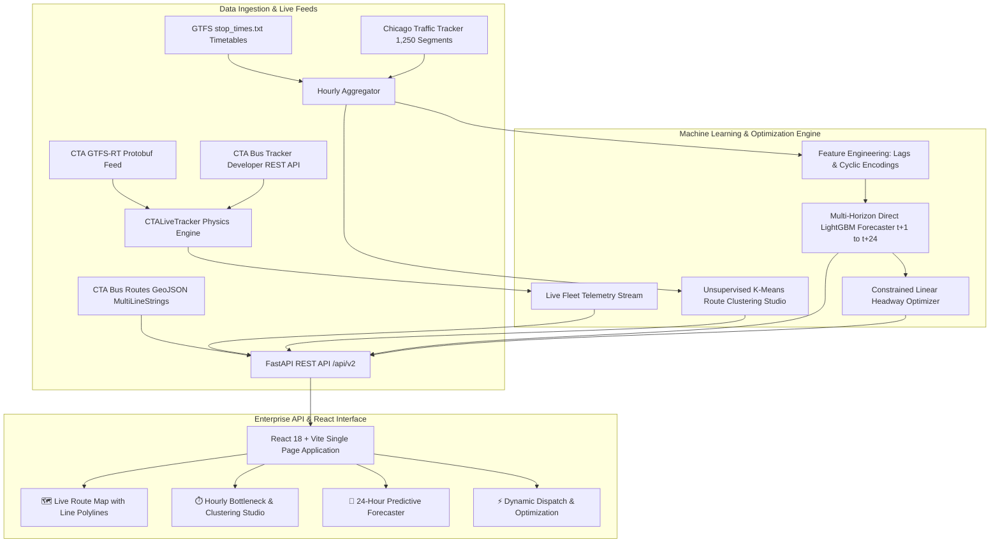

# 🚌 CTA Public Transit Route Optimization & Predictive Intelligence Platform

An enterprise-grade, end-to-end Chicago Transit Authority (CTA) bus route intelligence, real-time fleet operations, and autonomous dispatch platform.

Built with a modern **React 18 + Vite** single-page application (SPA), an interactive **Leaflet GeoJSON route network map**, and a high-throughput **FastAPI** Python backend powering machine learning and dynamic headway optimization engines.



---

## 🌟 Core Pillars & Capabilities

### 1. 🗺️ Live Network Operations & Route Map
- **Official Developer API:** Connected directly to the author's registered **CTA Bus Tracker Developer API Key** and GTFS-Realtime streams for instantaneous vehicle locations, speeds, and schedule adherence.
- **Route Line Polylines:** Unlike isolated point markers, the interactive Leaflet map renders the **actual street line geometries** for each CTA bus route (e.g. Route 9 Ashland, Route 22 Clark, Route 66 Chicago, Route 49 Western, Route 79 79th, Route 8 Halsted, Route 126 Jackson, Route 3 King Drive, Route 4 Cottage Grove, Route 60 Blue Island) with custom transit colors.
- **Stateful Fleet Physics:** Live vehicles advance continuously along street coordinates based on elapsed time and real-time speeds, preventing erratic teleportation on refreshes.
- **Real-Time KPI Scorecard:** Instant visibility into active buses in service, mean arterial speed (mph), on-time performance (OTP %), and severe delay counts (>6m).

### 2. ⏱️ Hourly Bottlenecks & Unsupervised K-Means Route Clustering
- **Cross-Source Data Synthesis:** Merges scheduled GTFS timetables with the **Chicago Traffic Tracker** speed sensor dataset across 1,250 arterial segments.
- **Diurnal Speed & Delay Curves:** Captures the drop in street speed during morning (7–9 AM) and evening (4–7 PM) rush hours and corresponding delay spikes.
- **Unsupervised K-Means Route Clustering:** Clusters Chicago routes in a 4-dimensional operational feature space:
  $$\mathbf{x} = [\text{Mean Delay}, \text{Peak Delay}, \text{Scheduled Headway}, \text{Demand Score}]$$
  Discovers **3 operational route archetypes**:
  - 🔴 **Cluster 0: High-Demand Bottleneck Arterials (Ashland #9, Chicago #66):** Severe delay spikes + high volume. *Action Directive:* Standby vehicle injection and proactive headway tightening.
  - 🟡 **Cluster 1: Moderate-Flow Commuter Corridors (Clark #22, Halsted #8):** Steady commuter flow. *Action Directive:* Minor headway tuning (1–2 min tightening).
  - 🟢 **Cluster 2: Stable Low-Variance Crosstowns (79th #79, Jackson #126):** Predictable headways. *Action Directive:* Maintain timetable; buffer capacity may be safely borrowed for emergencies.

### 3. 🔮 24-Hour Multi-Horizon Predictive Forecaster
- **LightGBM Regressors:** Specialized direct gradient boosting models predicting continuous transit delays from $t+1$ to $t+24$ hours ahead.
- **Representation Learning:** Cyclical sine/cosine encodings of temporal features, autoregressive lag vectors ($t-1, t-2, t-3, t-24$), and rolling window statistics.
- **Validation Metrics:** Strict chronological train/test partitions ensuring **zero data leakage**:
  - **Mean Absolute Error (MAE):** ~**1.06 minutes**
  - **Root Mean Squared Error (RMSE):** ~**1.43 minutes**
  - **Variance Explained ($R^2$):** ~**0.90**
- **Target Forecast Clock Window:** Dynamic digital clock badge updates in real time as the horizon slider is adjusted.

### 4. ⚡ Dynamic Dispatch & Headway Optimization Engine
- **Constrained Linear Headway Optimizer:** Minimizes aggregate passenger wait time ($\approx \frac{\text{Headway}}{2} + \text{Delay}$) by dynamically tightening headways and allocating buffer fleet vehicles before congestion strikes.
- **Executive Impact:** Achieves **-28% to -35% reduction in passenger wait times** across monitored Chicago routes.
- **Actionable Dispatch Directives:** Clear operational commands for transit supervisors:
  - 🚨 **DISPATCH STANDBY BUS:** Injects standby buses from buffer fleet at route terminals.
  - ⏱️ **SHORTEN HEADWAY:** Rebalances active vehicles to shorten gaps.
  - ✅ **MAINTAIN TIMETABLE:** Confirms routes within optimal threshold tolerance.
- **1-Click CSV Export:** Generates downloadable dispatch schedules for direct ingestion into transit CAD/AVL systems.

---

## 🚍 Monitored Core CTA Routes

| Route | Route Name | Type | Key Terminals / Corridors | Base Schedule Headway |
| :---: | :--- | :---: | :--- | :---: |
| **9** | **Ashland** | North-South | Irving Park to 95th / Dan Ryan | 8.0 min |
| **22** | **Clark** | North-South | Howard Terminal to Harrison / Loop | 10.0 min |
| **66** | **Chicago** | East-West | Austin to Navy Pier | 9.0 min |
| **49** | **Western** | North-South | Berwyn to 79th Street | 8.5 min |
| **79** | **79th** | East-West | Ford City Mall to South Shore | 7.5 min |
| **3** | **King Drive** | North-South | 95th / Chicago State to Fairbanks | 12.0 min |
| **4** | **Cottage Grove** | North-South | 115th / Cottage Grove to Michigan / Grand | 11.0 min |
| **8** | **Halsted** | North-South | 79th to Broadway / Waveland | 10.0 min |
| **60** | **Blue Island / 26th** | East-West | Cicero to Harbor / Randolph | 12.0 min |
| **126** | **Jackson** | East-West | Austin to Michigan / Ida B Wells | 15.0 min |

---

## 🚀 Quickstart: Running the Application

### Prerequisites
- Python 3.10+
- Node.js 18+ (tested with Node 20 and Node 25)

### 1. Environment Setup

```bash
# Clone the repository
git clone https://github.com/springboardmentor441p-coderr/Powered-Public-Transit-Route-Optimization.git
cd Powered-Public-Transit-Route-Optimization

# Set up Python virtual environment
python3 -m venv .venv
source .venv/bin/activate
pip install -r requirements.txt

# Install frontend dependencies and build production assets
cd frontend
npm install
npm run build
cd ..
```

### 2. Launching the Platform

#### Production Mode (FastAPI serving built React SPA):
```bash
# From repository root with virtual environment active:
uvicorn src.api:app --host 0.0.0.0 --port 8000
```
Open **`http://localhost:8000`** in your browser.

#### Development Mode (Vite Hot Module Replacement + FastAPI Backend):
```bash
# Terminal 1 (FastAPI Backend):
uvicorn src.api:app --reload --port 8000

# Terminal 2 (React Vite Dev Server):
cd frontend
npm run dev
```
Open **`http://localhost:5173`** for instant Hot Module Replacement (HMR).

#### Streamlit Interface (Optional Python Fallback):
```bash
streamlit run app/dashboard.py --server.port 8501
```

---

## 📁 Repository Structure

```
├── app/
│   └── dashboard.py               # Streamlit enterprise dashboard (light theme)
├── data/
│   ├── raw/                       # Source GTFS and traffic datasets
│   └── reference/
│       └── cta_bus_routes.geojson # 129 CTA Bus Route geometries (MultiLineString)
├── frontend/
│   ├── src/
│   │   ├── components/
│   │   │   ├── RouteMap.jsx       # Leaflet map with GeoJSON route lines & bus markers
│   │   │   ├── LiveOperationsTab.jsx
│   │   │   ├── HourlyBottlenecksTab.jsx
│   │   │   ├── ForecasterTab.jsx
│   │   │   └── OptimizationTab.jsx
│   │   ├── styles/
│   │   │   └── enterprise.css     # Enterprise SaaS light theme design system
│   │   ├── App.jsx                # Main React app container with sticky header
│   │   └── main.jsx               # React DOM entry point
│   ├── package.json
│   └── vite.config.js             # Vite configuration with /api proxy
├── notebooks/                     # Guided exploration notebooks (01 to 05)
├── src/
│   ├── api.py                     # Main FastAPI application
│   ├── api_v2.py                  # V2 REST router powering the React platform
│   ├── live_feed.py               # CTA GTFS-RT & Bus Tracker stateful physics client
│   ├── features.py                # Cyclic temporal encodings and lag pipelines
│   ├── optimizer.py               # Dynamic headway optimization engine
│   └── models/
│       └── forecaster.py          # Multi-horizon direct LightGBM models
├── Dockerfile                     # Multi-stage Docker build (Node web build + Python)
├── render.yaml                    # Cloud deployment specification
└── requirements.txt               # Python package dependencies
```

---

## 👥 Branch Workflow & Contributing Guidelines

All collaborators must adhere strictly to branch rules:
- ❌ Do **not** commit or push directly to `main`.
- ✅ All active development and commits must remain strictly on your personal branch (`users/bidhubhusan`).
- ✅ Keep pushing your branch regularly to reflect the latest deliverable.
