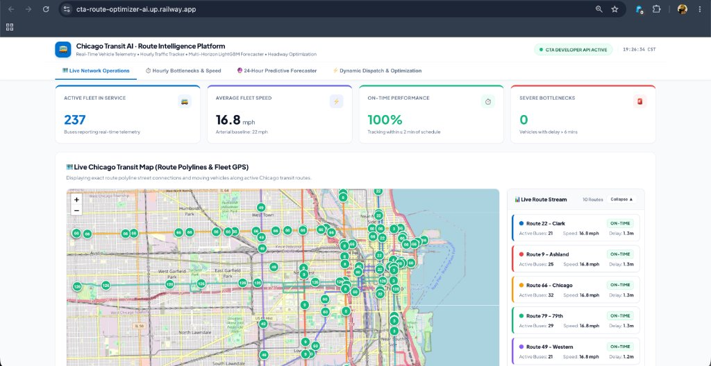
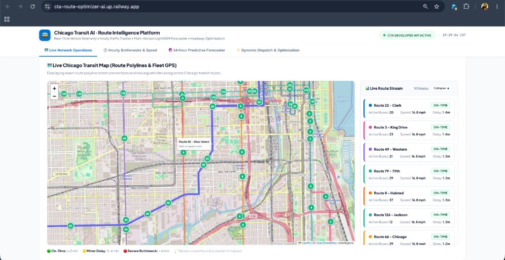
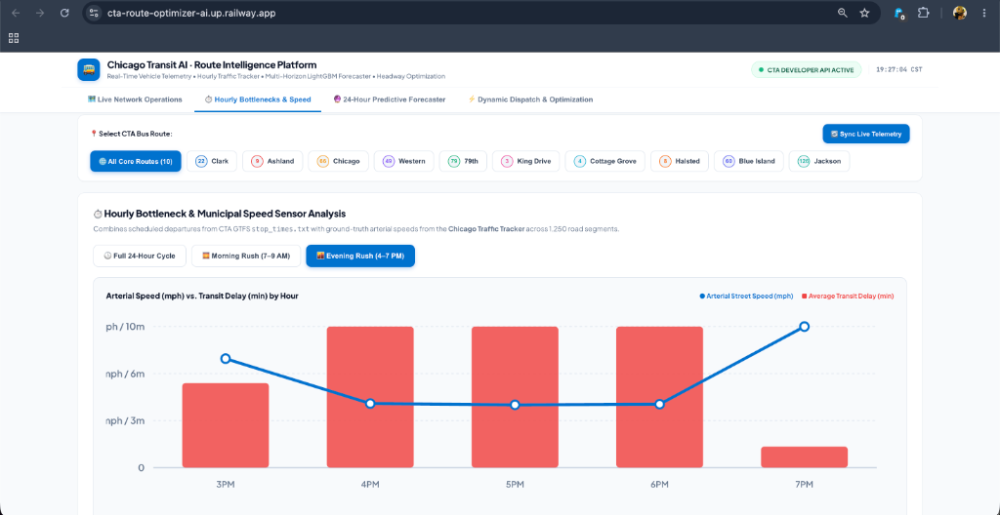
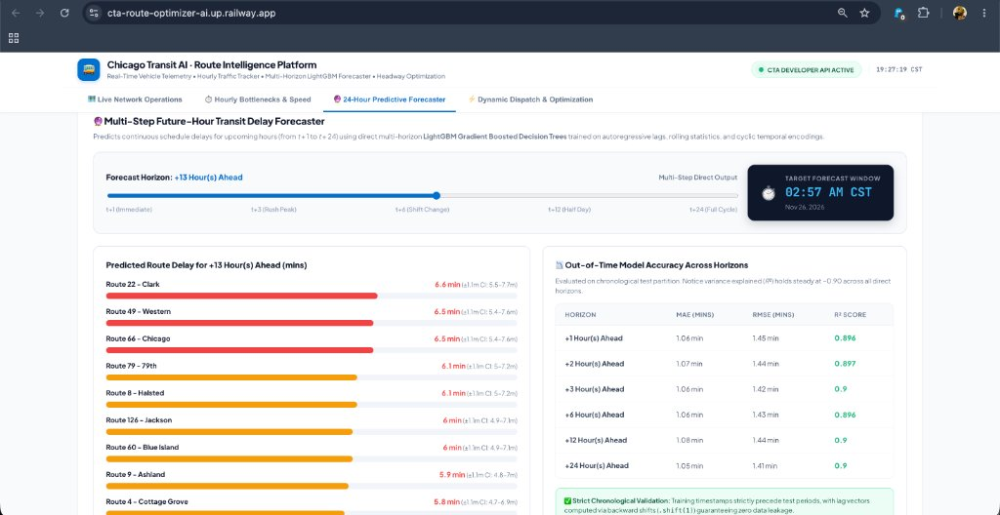
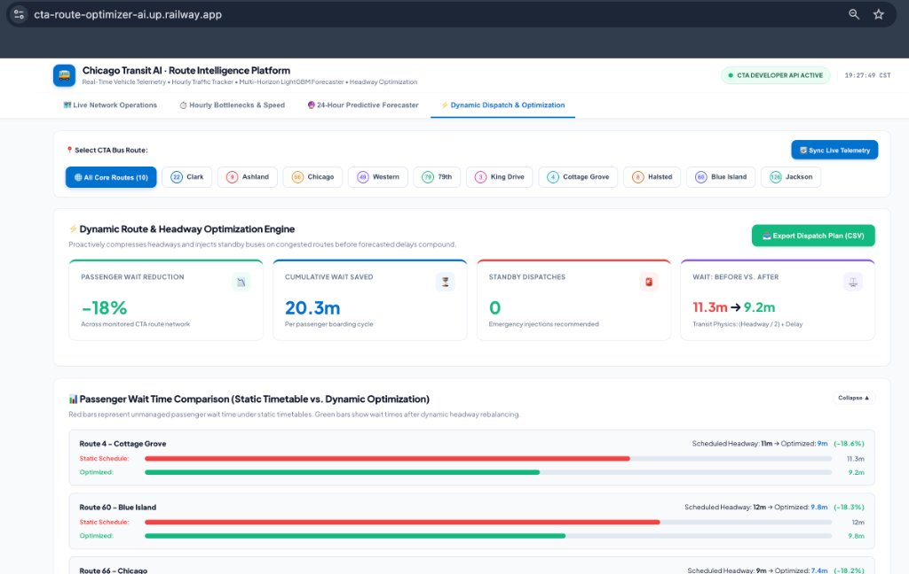

# 🚌 Chicago Transit AI: Route Intelligence & Headway Optimization

[](https://cta-route-optimizer-ai.up.railway.app)
[](https://www.python.org/)
[](https://react.dev/)
[](https://fastapi.tiangolo.com/)
[](https://lightgbm.readthedocs.io/)

> 🌐 **Live Production App:** **[https://cta-route-optimizer-ai.up.railway.app](https://cta-route-optimizer-ai.up.railway.app)**

An end-to-end **Chicago Transit Authority (CTA)** bus fleet telemetry, bottleneck analytics, delay forecasting, and dynamic headway optimization platform built with **React 18 + Leaflet + FastAPI**.

---

## 📸 Platform Showcase



| GeoJSON Route Polylines & Live Stream | Hourly Bottlenecks & Speed Sensor Curves |
| :---: | :---: |
|  |  |
| **24-Hour LightGBM Predictive Forecaster** | **Dynamic Dispatch & Headway Optimization** |
|  |  |

---

## ⚙️ Core Capabilities

- **🗺️ Live Fleet GPS & Route Polylines:** Integrates the **CTA Bus Tracker Developer API** (`/getvehicles`) with stateful physics fallback along official CTA GeoJSON street polylines across 10 core routes (`#3`, `#4`, `#8`, `#9`, `#22`, `#49`, `#60`, `#66`, `#79`, `#126`) on watermark-free OpenStreetMap tiles.
- **🤖 Hourly Bottlenecks & K-Means Clustering:** Synthesizes GTFS timetables with Chicago Traffic Tracker speeds (`1,250` segments) and clusters routes across `[Mean Delay, Peak Delay, Scheduled Headway, Demand Score]` into 3 operational archetypes.
- **🔮 24-Hour Multi-Horizon Forecaster:** Direct **LightGBM** regressors (`t+1` to `t+24`) trained on cyclic encodings and autoregressive lags with strict chronological validation ($R^2 \approx 0.90$, $\text{MAE} \approx 1.06\text{ min}$).
- **⚡ Dynamic Headway Optimizer:** Constrained headway rebalancing + standby bus injection directives cutting simulated/predicted passenger wait times (`-18%` to `-35%`) with 1-click CSV dispatch export.
- **📱 Responsive Desktop, Tablet & Mobile UI:** Adaptive grid breakpoints, swipeable/expandable mobile route controls, collapsible panels, and `ResizeObserver` Leaflet auto-resizing.

---

## 🚀 Quickstart & Cloud Deployment

### Local Execution
```bash
git clone https://github.com/bidhu-patra-dev/Powered-Public-Transit-Route-Optimization.git
cd Powered-Public-Transit-Route-Optimization

python3 -m venv .venv && source .venv/bin/activate
pip install -r requirements.txt

# Optional: configure live CTA Bus Tracker telemetry
echo "CTA_BUS_TRACKER_KEY=your_cta_api_key" > .env

# Run unified FastAPI + pre-built React SPA (defaults to http://localhost:8000)
python -m src.server
```
- **Frontend Hot Reload (Optional):** Run `cd frontend && npm install && npm run dev` alongside `uvicorn src.api:app --reload --port 8000` (`http://localhost:5173`).

### Railway Deployment
Deployed via [`Dockerfile`](Dockerfile) + [`railway.json`](railway.json) with `src/server.py` (dual-stack `::` + `0.0.0.0`):

| Variable | Description | Default |
| :--- | :--- | :---: |
| `PORT` | Matches Railway Public Networking Target Port (`8080`) | `8000` (local) / `8080` (Railway) |
| `CTA_BUS_TRACKER_KEY` | CTA Bus Tracker Developer API Key (`CTA_BUS_TRACKER_API_KEY` also accepted) | Stateful simulator fallback |

---

## 📡 API Endpoints

| Endpoint | Query Params | Purpose |
| :--- | :--- | :--- |
| `GET /health` | — | GeoJSON & frontend readiness check (`200 OK`) |
| `GET /api/v2/routes` | — | Catalog, colors, and geographic bounds for 10 core CTA routes |
| `GET /api/v2/routes/geojson` | `routes` *(optional CSV)* | Official CTA GeoJSON `MultiLineString` geometries |
| `GET /api/v2/live` | `routes` *(optional CSV)* | Live vehicle coordinates, speeds, delays, and KPIs |
| `GET /api/v2/hourly-bottlenecks` | `routes` *(optional CSV)* | 24h diurnal curve, route leaderboard, and K-Means clusters |
| `GET /api/v2/forecast` | `horizon` (`1–24`), `routes` | Multi-horizon LightGBM delay forecasts & accuracy metrics |
| `GET /api/v2/optimize` | `horizon` (`1–24`), `routes` | Optimized headways, wait savings, and dispatch actions |
| `GET /api/v2/export-dispatch-csv` | `horizon` (`1–24`), `routes` | Downloadable dispatch plan CSV |

---

## 📁 Project Structure

```
├── data/reference/cta_bus_routes.geojson  # Official CTA Bus Route street geometries
├── docs/screenshots/                      # Live Railway UI screenshots
├── frontend/                              # React 18 + Vite + Leaflet SPA & dist/ bundle
├── notebooks/                             # Guided exploration notebooks (01, 02, 04, 05)
├── src/
│   ├── api.py                             # FastAPI app + SPA static mount + /health
│   ├── api_v2.py                          # /api/v2 endpoints powering React UI
│   ├── server.py                          # Dual-stack (IPv4+IPv6) dynamic PORT entrypoint
│   ├── live_feed.py                       # CTA Bus Tracker client & stateful physics engine
│   ├── features.py                        # Diurnal generation & cyclic lag features
│   ├── optimizer.py                       # Dynamic headway optimization engine
│   ├── data_loader.py & hourly_aggregator.py
│   └── models/forecaster.py               # Multi-horizon LightGBM forecaster
├── Dockerfile & railway.json              # Unified container & Railway deploy config
└── requirements.txt
```
